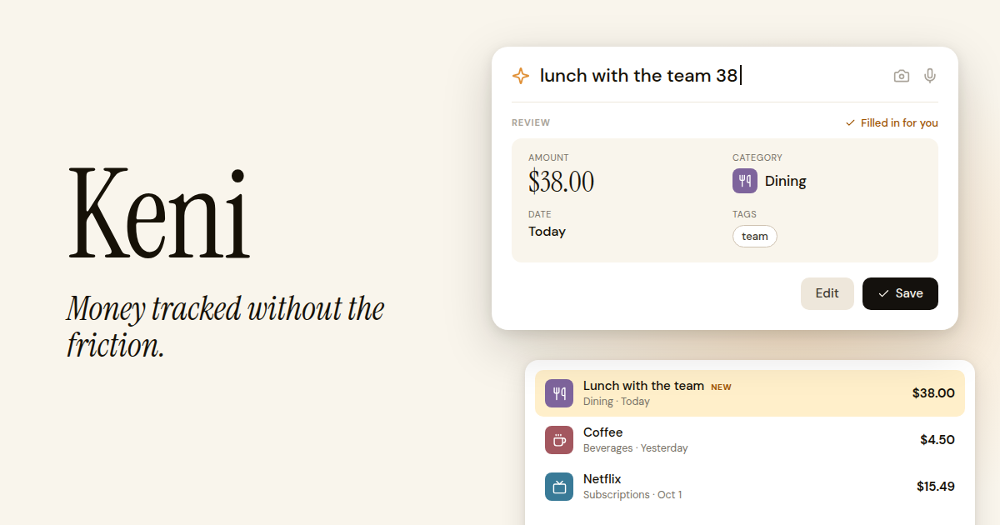

# Keni

[Official website](https://keni.seria.moe) | [Hosted instance](https://app.keni.seria.moe)

Keni is a personal finance tracker built for people who want to record detailed transaction logs without spending much effort.
It uses AI to take various kind of input (text, image, PDF, voice, etc.) and extract context about the transaction, then categorizes them for easier lookup in the future.

Keni is built with privacy in mind. You can [self-host](docs/self-hosting.md) with Docker Compose for full data control, or try it out for free with the hosted instance.
For AI, Keni uses BYOK (bring your own key) and does not come with any cloud AI models. You can easily get free API keys from [Google Gemini](https://aistudio.google.com/) or [OpenRouter](https://openrouter.ai/). When self-hosting, you can also run local models with Ollama, LM Studio or vLLM, or connect any other OpenAI-compatible endpoint, so your transactions and receipts never leave hardware you control.

## Demo

<https://github.com/user-attachments/assets/28d2920a-3d04-40c7-b652-16b8c19a7fdb>

## Features

- Ctrl+K to log anything: Use the command bar to record income, spending, recurring bills, grouped expenses, or multiple transactions at once. With AI, Keni infers context, categorizes with high detail, and fills in the blanks.
- Receipt & invoice scanning: Upload a photo of a paper receipt or a PDF e-invoice. The AI reads the total, line items, merchant, and date, then records it for you.
- Chat with your data: Ask anything in plain language, like chatting with a personal finance advisor. Get real answers from your actual numbers.
- Model agnostic: Bring your own API key. Keni works with OpenAI, OpenRouter, Anthropic, and Google Gemini. Self-hosters can also use local models through any OpenAI-compatible server (Ollama, LM Studio, vLLM).
- Voice input: Tap the mic and speak your expense. Audio is processed locally, nothing leaves your server.
- Multiple wallets: Separate personal, business, travel, or shared expenses across wallets. Each wallet has its own currency, history, and analytics - perfect for people living across borders.
- Categories & tags: Organize expenses with categories and tags. The AI suggests both automatically based on context, reducing your input to near zero. Filter by either when reviewing your history.
- MCP & API: Connect Keni to your favorite AI agents via MCP, or integrate with third-party tools using your personal API key.
- Budgets: Set budgets by period, category, or wallet. Get a visual warning right on the dashboard when you are close to or exceeding your limit.
- Dashboard analytics: Monthly total, weekly pace, daily average, recent transactions, and a category breakdown chart.

## Self-Hosting

See [docs/self-hosting.md](docs/self-hosting.md) for setup, configuration and using local AI models.

## Android app

Keni has an Android app: the same Keni, from the hosted instance or your own server, with Android's share sheet (send a receipt or text from any app to Keni), Back button, launcher shortcuts (long-press the icon for "Add transaction" and "Voice entry") and exports saved to Downloads.

1. On your phone, download `keni.apk` from the [latest release](https://github.com/seriaati/keni/releases/latest) (Android browsers also get a "Get the Android app" button in Keni's menu) and open it. Android asks you to allow installing apps from your browser.
2. The app asks for your server, prefilled with the hosted instance (`keni-api.seria.moe`). To use your own server, enter its HTTPS address instead. With the Docker Compose setup that's the one address both parts share. If you host the frontend and the backend apart, enter either one: for the backend's address, set its `MCP_FRONTEND_URL` to the frontend's address, which the app reads from `/api/health`.
3. To switch servers later, open **Settings → Profile → Android app → Change server**. This logs you out of the current server; your data on it stays as it is.

**Updates.** When a newer release is out, the app says "A new version of the app is out." Tap **Update**: your browser downloads the new `keni.apk`; open it and Android installs it over the old app, keeping your login. The app asks GitHub for the latest release when it starts and every few hours. Apps like [Obtainium](https://github.com/ImranR98/Obtainium) can also track the Releases page.

**Building it yourself** (optional). You need Docker; no Android tools are needed:

```sh
scripts/build-android.sh
```

The first build takes several minutes, mostly downloading the Android build tools (kept in `~/.cache/keni-android`), and writes `frontend/android/keni.apk`. It also creates the key your build is signed with: `frontend/android/keni.keystore` and its password in `frontend/android/keystore.properties`. Back both up: Android installs an app over another only when both are signed with the same key, so your build and the release app can't update each other (uninstall one before installing the other). A build of your own doesn't look for updates.
